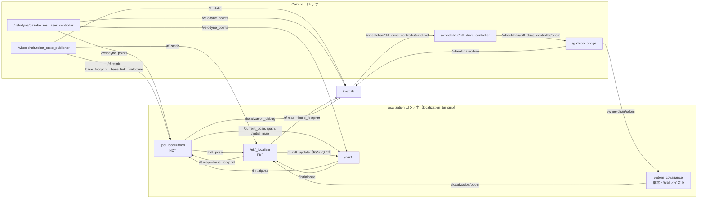
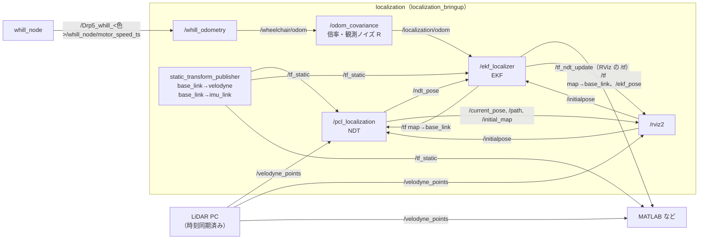
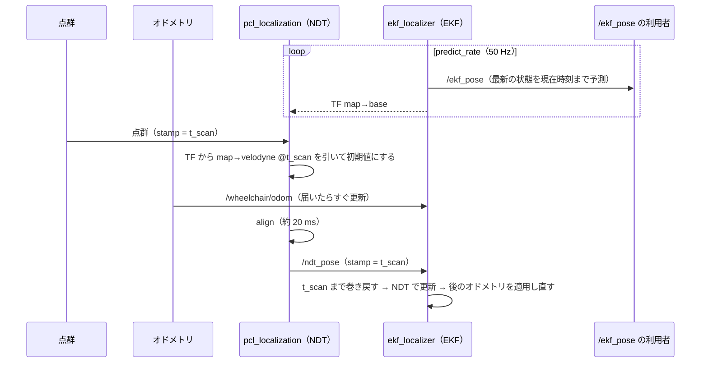

# ノード間通信

`localization.launch.py` で起動したときのノード・トピック・TF のつながりです（今の環境ファイルの値）。
起動するノードとトピックの名前は、環境ファイルの `nodes.<ノード名>`（`enable`・`topics`）で変えられます。
`env:=gazebo` は動作を確認済みです。実機（`env:=red`・`blue`・`white`。車椅子の色だけが違う）は設定ファイルから書いたもので、実機ではまだ確認していません。

## Gazebo（`env:=gazebo`）

- 時刻：Gazebo が配信する `/clock`（100 Hz）に、localization の全ノードが従います（`use_sim_time: true`）。図では省略しています。
- 点群・オドメトリの stamp：sim time でそろっているので、そのまま使います（`stamp_mode: stamp`）。
- MATLAB：点群は `/velodyne_points` をそのまま使い、`ros2tf` で `/tf`・`/tf_static` を溜めて、後輪間中心は最新の map → base、
  LiDAR の姿勢は点群の stamp の時刻の map → velodyne を引きます（2026-10-26 から。それまでの `/localization/base_pose`・`vlp16_pose`・
  `vlp16_points` はやめた）。
- 通信：localization コンテナ、Gazebo コンテナ、MATLAB の 3 つとも、同じ Fast DDS プロファイル（`fastdds_localhost.xml`）で localhost だけで通信します。LAN 上の他の ROS 2 とはつながりません。

## 実機（`env:=red`・`blue`・`white`）

- 時刻：自己位置推定の PC とラズパイ（点群とオドメトリの元）は時刻同期しているので、stamp をそのまま使います（`stamp_mode: stamp`）。
  `false`（受信した時刻にする）か `auto`（受信した時刻と 0.1 s 以上ずれていたら受信した時刻にする）にすると、
  点群は `cloud_stamp_corrector` が直して `/localization/points` で NDT に渡し、オドメトリは `odom_covariance` が直します。
- 取付：launch が環境ファイル（`red.yaml` など）の `static_tfs` を静的 TF として配信します。
- 通信：LiDAR PC と LAN 越しに通信するので、localhost だけに絞るプロファイルは使いません。

## 処理の流れ（NDT の遅れと巻き戻し）

- EKF は、観測とそのときの状態を `history_length`（1.0 秒）分だけ保持します。これより古い `/ndt_pose` は捨てて WARN を出します。
- NDT が TF を引けないとき（EKF の初期化前、`/initialpose` を受けた直後の 1 秒間）は、前回の NDT の解か、与えられた初期姿勢を初期値にします。

## トピック

| トピック | 型 | 配信 | 購読 | QoS | 周期 | 内容 |
|---|---|---|---|---|---|---|
| `/velodyne_points` | `sensor_msgs/PointCloud2` | Gazebo / LiDAR PC | NDT（`stamp_mode: stamp` のとき。今は Gazebo・実機とも）、MATLAB | NDT 側は best effort、KeepLast(1) | 10 Hz（Gazebo）、20 Hz（実機） | 点群 |
| `/localization/points` | `sensor_msgs/PointCloud2` | `cloud_stamp_corrector` | NDT、RViz | reliable、KeepLast(1) | 点群と同じ | stamp をこの PC の時計に直した点群（`stamp_mode` が `receipt`・`auto` のときだけ） |
| `/wheelchair/odom` | `nav_msgs/Odometry` | `gazebo_bridge` / `whill_odometry` | `odom_covariance`、MATLAB | `odom_covariance` 側は best effort（sensor data） | 50 Hz | 使うのは `twist.linear.x`（v）と `twist.angular.z`（omega） |
| `/localization/odom` | `nav_msgs/Odometry` | `odom_covariance` | EKF | 配信は reliable、KeepLast(10)。EKF 側は best effort、KeepLast(50) | 50 Hz | v・omega に倍率（`odom_scale`）を掛け、twist の共分散に観測ノイズ R を入れたもの（EKF は `odom_covariance_source: message` で R に使う） |
| `/ndt_pose` | `geometry_msgs/PoseWithCovarianceStamped` | NDT | EKF | reliable、KeepLast(10) | 約 10 Hz | NDT の解。map → LiDAR、stamp は点群の取得時刻 |
| `/ekf_pose` | `geometry_msgs/PoseWithCovarianceStamped` | EKF | テスト走行（`drive_test.py`。範囲の監視） | reliable、transient_local、KeepLast(1) | 50 Hz | EKF の推定。map → LiDAR、stamp は現在時刻（`/tf` と同じ値） |
| `/ekf_odom` | `nav_msgs/Odometry` | EKF | （なし） | reliable、KeepLast(10) | 50 Hz | map → base の姿勢と、base 座標での v・omega |
| `/current_pose` | `geometry_msgs/PoseWithCovarianceStamped` | NDT（`pcl_pose` をリマップ） | RViz | reliable、transient_local、KeepLast(1) | 約 10 Hz | NDT の解。`pose_output_frame: "lidar"` なので map → LiDAR |
| `/path` | `nav_msgs/Path` | NDT | RViz | reliable、transient_local、KeepLast(1) | 約 10 Hz | NDT の解（base）の軌跡 |
| `/tf_ndt_update` | `tf2_msgs/TFMessage` | EKF（`publish_ndt_update_tf`） | RViz（launch が RViz の `/tf` を付け替える） | reliable、KeepLast(100) | NDT と同じ | NDT で更新した直後の map → base（点群の時刻の事後推定値）。stamp は点群の取得時刻 |
| `/initial_map` | `sensor_msgs/PointCloud2` | NDT | RViz | reliable、transient_local、KeepLast(1) | 起動時 1 回 | 読み込んだ PCD 地図 |
| `/localization_debug` | `std_msgs/Float32MultiArray` | NDT | MATLAB | reliable、transient_local、KeepLast(1) | 約 10 Hz | [点数, align 時間 s, 収束, fitness, 初期値との角度差 deg] |
| `/initialpose` | `geometry_msgs/PoseWithCovarianceStamped` | RViz（2D Pose Estimate） | NDT、EKF | system default | 手動 | NDT は初期姿勢を置き換え、EKF はリセットして次の NDT で初期化し直す |

## TF

| 変換 | 配信 | 使うノード |
|---|---|---|
| map → base（Gazebo：`base_footprint`、実機：`base_link`） | EKF（`/tf`。`predict_rate` 50 Hz の周期で、現在時刻まで予測した値） | NDT（点群の取得時刻の値を補間して初期値に使う）、MATLAB（最新の値を後輪間中心に、点群の取得時刻の値を点群の座標変換に使う） |
| map → base（RViz 用） | EKF（`/tf_ndt_update`。NDT で更新した直後の値を点群の時刻で） | RViz（`/tf` を付け替えて読む。点群 `/velodyne_points` はこの値で map に直される） |
| `base_footprint` → `base_link` → `velodyne_base_link` → `velodyne` | `robot_state_publisher`（URDF、Gazebo） | NDT・EKF（base → LiDAR の取付として読む）、MATLAB |
| `base_link` → `velodyne`、`base_link` → `imu_link` | launch の `static_transform_publisher`（実機） | NDT・EKF（同上）、MATLAB |

`use_ekf:=false`（か `nodes.ekf_localizer.enable: false`）で起動したときは EKF が起動しないので、map → base は NDT が配信し、`/ndt_pose` を購読するノードはなくなります（RViz の `/tf` も付け替えません）。

Gazebo で launch からも同じ子フレーム（`velodyne` など）を配信すると親が 2 つになり、取付として使われる値が到着順で変わります
（ノードごとに違う値を読むこともあります）。そのため `gazebo.yaml` の `static_tfs` は空にしています。
