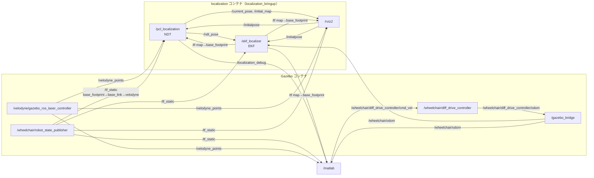
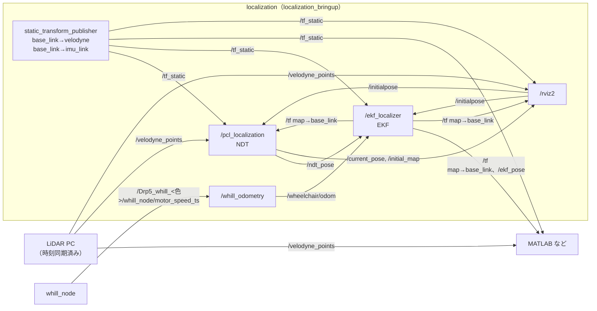
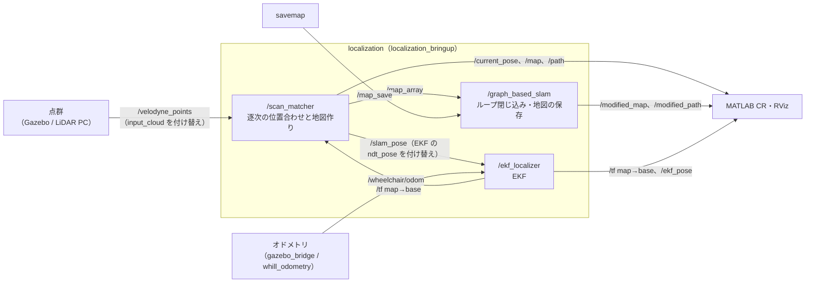
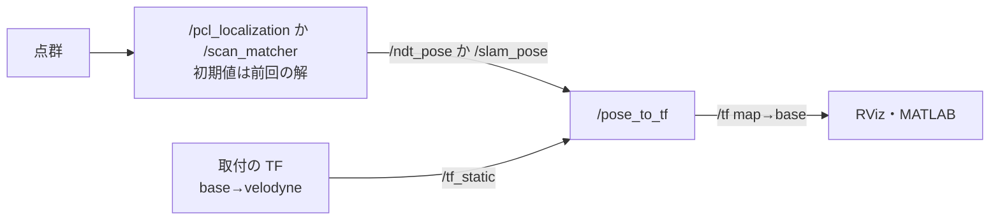
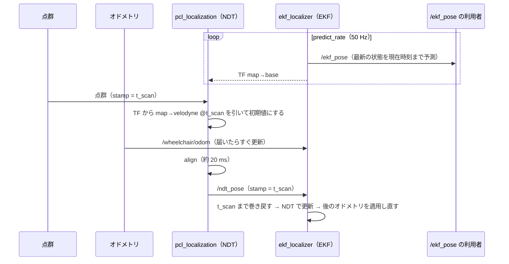

# ノード間通信

`localization.launch.py` で起動したときのノード・トピック・TF のつながりです（今の環境 `param/<env>/` の値）。
起動するノードは `env.yaml` の `nodes` で選びます。トピックは各ノードの名前のままでつながり、launch が付け替えるのは
ekf_localizer の `odom` → `/wheelchair/odom` と NDT の `pcl_pose` → `/current_pose` だけです（2026-11-11 から。それまでの `odom_relay`（倍率・時刻）は ekf_localizer に移しました）。
`env:=gazebo` と実機 blue の録画の再生は動作を確認済みです。
SLAM（`lidarslam.launch.py`、コマンド `lidarslam`）のときは、下の「lidarslam」の節の形になります（2026-11-12 から）。

## Gazebo（`env:=gazebo`）

- 時刻：Gazebo が配信する `/clock`（100 Hz）に、localization の全ノードが従います（`use_sim_time: true`）。図では省略しています。
- 点群・オドメトリの stamp：sim time でそろっているので、そのまま使います（`stamp_mode: stamp`）。
- MATLAB：点群は `/velodyne_points` をそのまま使い、`ros2tf` で `/tf`・`/tf_static` を溜めて、後輪間中心は最新の map → base、
  LiDAR の姿勢は点群の stamp の時刻の map → velodyne を引きます（2026-10-26 から。それまでの `/localization/base_pose`・`vlp16_pose`・
  `vlp16_points` はやめた）。
- RViz：MATLAB と同じく `/tf` をそのまま読み、点群はその stamp の時刻の map → base（予測値の補間）で、視点（Target Frame `base_link`）は
  最新の値で表示します（2026-10-26 から。2026-10-19〜26 は `/tf` を ekf_localizer の `/tf_ndt_update`（NDT で更新した直後の値）に付け替えていた。`/tf_ndt_update` と RViz の EKFPose（`/ekf/pose`）の表示は 2026-10-26 にやめた）。
- 通信：localization コンテナ、Gazebo コンテナ、MATLAB の 3 つとも、同じ Fast DDS プロファイル（`fastdds_localhost.xml`）で localhost だけで通信します。LAN 上の他の ROS 2 とはつながりません。

## 実機（`env:=red`・`blue`・`white`）

- 時刻：自己位置推定の PC とラズパイ（点群とオドメトリの元）は時刻同期しているので、stamp をそのまま使います
  （`pcl_localization.yaml` の `stamp_mode: stamp`、`ekf_localizer.yaml` の `odom_stamp_mode: stamp`）。
  `receipt`（受信した時刻にする）か `auto`（受信した時刻と 0.1 s 以上ずれていたら受信した時刻にする）にすると、
  NDT は `/ndt_pose` の stamp に点群の受信時刻を入れ、EKF はオドメトリを受け取った時刻を使います。点群のトピック自体の stamp は変えません。
- 取付：launch が `env.yaml` の `static_tfs` を静的 TF として配信します。
- 通信：LiDAR PC と LAN 越しに通信するので、localhost だけに絞るプロファイルは使いません。

## lidarslam（`lidarslam.launch.py`、`matcher:=lidarslam`）

pcl_localization の代わりに、lidarslam_ros2 の scan_matcher と graph_based_slam を起動します。環境（`param/<env>/`）は NDT のときと同じで、
SLAM のパラメータは `param/<env>/lidarslam.yaml` です。オドメトリ・取付・MATLAB・RViz とのつながりは上の図と同じなので省いています。

- scan_matcher：点群が届くたびに、直近の部分地図 20 個（`num_targeted_cloud`）をつないだ地図に NDT で合わせます。初期値は NDT と同じく、
  EKF の TF の点群の時刻の map → velodyne（`use_tf_init_guess`。引けなければ前回の解）。`robot_frame_id: velodyne` なので解は LiDAR の姿勢で、
  点群は変換しません。1.5 m 進むごとに部分地図を足して `/map_array` を出します。TF は出しません（`publish_tf: false`）。
- graph_based_slam：`/map_array` からループを探してグラフ最適化し、`/modified_map` を出します。savemap（サービス `/map_save`）で `map.pcd` と
  `pose_graph.g2o` を launch の作業ディレクトリに書きます。最適化で直した姿勢は scan_matcher と EKF には戻りません（直るのは保存する地図だけ）。
- EKF は `/slam_pose` を NDT の解と同じに扱います（`R_ndt` も同じ値）。
- RViz は lidarslam の `mapping.rviz`（`/map`・`/modified_map`・`/path`・`/current_pose`）。
- `/initialpose` は scan_matcher には届きません（scan_matcher が購読するのは PoseStamped の `/initial_pose`）。初期姿勢は `lidarslam.yaml` で与えます。

## EKF を起動しないとき（`use_ekf:=false`）

`pose_to_tf`（このパッケージの `scripts/pose_to_tf.py`）が、解（map → LiDAR）に取付 base → LiDAR の逆を掛けた map → base を、解の stamp で配信します
（NDT が `publish_tf` で出していたものと同じ計算。フレームの名前は `ekf_localizer.yaml` の値）。NDT・scan_matcher は TF を出さず、
TF を初期値にもしません（`use_tf_init_guess: false`）。2026-11-12 までは NDT が自分で TF を出していました。

## 処理の流れ（NDT の遅れと巻き戻し）

- EKF は、観測とそのときの状態を `history_length`（1.0 秒）分だけ保持します。これより古い `/ndt_pose` は捨てて WARN を出します。
- NDT が TF を引けないとき（EKF の初期化前、`/initialpose` を受けた直後の 1 秒間）は、前回の NDT の解か、与えられた初期姿勢を初期値にします。

## トピック

| トピック | 型 | 配信 | 購読 | QoS | 周期 | 内容 |
|---|---|---|---|---|---|---|
| `/velodyne_points` | `sensor_msgs/PointCloud2` | Gazebo / LiDAR PC | NDT、MATLAB | NDT 側は best effort、KeepLast(1) | 10 Hz（Gazebo）、20 Hz（実機） | 点群 |
| `/wheelchair/odom` | `nav_msgs/Odometry` | `gazebo_bridge` / `whill_odometry` | EKF（`odom` を付け替え）、MATLAB | EKF 側は best effort、KeepLast(50) | 50 Hz | 使うのは `twist.linear.x`（v）と `twist.angular.z`（omega）。EKF が倍率 `odom_scale` を掛け、`odom_stamp_mode` で時刻を決める（twist の共分散は使わない。観測ノイズ R は EKF が計算する）。2026-11-11 まで `odom_relay` を通して `/localization/odom` に中継していた |
| `/ndt_pose` | `geometry_msgs/PoseWithCovarianceStamped` | NDT | EKF | reliable、KeepLast(10) | 約 10 Hz | NDT の解。map → LiDAR、stamp は点群の取得時刻 |
| `/ekf_pose` | `geometry_msgs/PoseWithCovarianceStamped` | EKF | テスト走行（`drive_test.py`。実機の走行の監視） | reliable、transient_local、KeepLast(1) | 50 Hz | EKF の推定。map → LiDAR、stamp は現在時刻（`/tf` と同じ値） |
| `/ekf_odom` | `nav_msgs/Odometry` | EKF | （なし） | reliable、KeepLast(10) | 50 Hz | map → base の姿勢と、base 座標での v・omega |
| `/current_pose` | `geometry_msgs/PoseWithCovarianceStamped` | NDT（`pcl_pose` を付け替え） | RViz、研究室の MATLAB（CR の実機モード） | reliable、transient_local、KeepLast(1) | 約 10 Hz | NDT の解。`pose_output_frame: "lidar"` なので map → LiDAR |
| ~~`/path`~~ | `nav_msgs/Path` | NDT | （なし） | — | — | NDT の解（base）の軌跡。2026-11-11 に配信をやめた（読み手がいないのに、点群ごとに軌跡全体を配信して伸び続けていた。NDT のソースでコメントアウト） |
| `/slam_pose` | `geometry_msgs/PoseWithCovarianceStamped` | scan_matcher（lidarslam） | EKF（`ndt_pose` を付け替え）、pose_to_tf | reliable、KeepLast(10) | 点群ごと | lidarslam の解。`/ndt_pose` と同じ型・QoS。map → LiDAR、stamp は点群の取得時刻、共分散は 0 |
| `/current_pose`（lidarslam） | `geometry_msgs/PoseStamped` | scan_matcher | RViz（`mapping.rviz`）、研究室の MATLAB（CR の実機モードの sensor 4） | KeepLast(10) | 点群ごと | lidarslam の解（map → LiDAR）。NDT のときの `/current_pose` とは型が違う |
| `/map_array` | `lidarslam_msgs/MapArray` | scan_matcher | graph_based_slam | reliable、KeepLast(1) | 1.5 m ごと | 部分地図（点群と姿勢）の列 |
| `/map`・`/modified_map` | `sensor_msgs/PointCloud2` | scan_matcher・graph_based_slam | RViz | KeepLast(10) | 15 s ごと・ループ閉じ込み時 | 作っている地図・ループで直した地図 |
| `/initial_map` | `sensor_msgs/PointCloud2` | NDT | RViz | reliable、transient_local、KeepLast(1) | 起動時 1 回 | 読み込んだ PCD 地図 |
| `/localization_debug` | `std_msgs/Float32MultiArray` | NDT | MATLAB | reliable、transient_local、KeepLast(1) | 約 10 Hz | [点数, align 時間 s, 収束, fitness, 初期値との角度差 deg] |
| `/initialpose` | `geometry_msgs/PoseWithCovarianceStamped` | RViz（2D Pose Estimate） | NDT、EKF | system default | 手動 | NDT は初期姿勢を置き換え、EKF はリセットして次の NDT で初期化し直す |

## TF

| 変換 | 配信 | 使うノード |
|---|---|---|
| map → base（Gazebo：`base_footprint`、実機：`base_link`） | EKF（`/tf`。`predict_rate` 50 Hz の周期で、現在時刻まで予測した値。ekf_localizer の `tf_future_steps` が 1 以上なら（環境ファイルは 4 つとも 2、`tf_past_steps` 1）、stamp を周期の刻みにそろえて今より先の刻みも送り、同じ刻みは送り直して置き換える） | NDT（点群の取得時刻の値を補間して初期値に使う）、MATLAB・RViz（最新の値を後輪間中心（RViz は視点の Target Frame `base_link`）に、点群の取得時刻の値を点群の座標変換に使う） |
| `base_footprint` → `base_link` → `velodyne_base_link` → `velodyne` | `robot_state_publisher`（URDF、Gazebo） | NDT・EKF（base → LiDAR の取付として読む）、MATLAB・RViz |
| `base_link` → `velodyne`、`base_link` → `imu_link` | launch の `static_transform_publisher`（実機） | NDT・EKF（同上）、MATLAB・RViz |

`use_ekf:=false`（か `env.yaml` の `nodes.ekf_localizer: false`）で起動したときは EKF が起動しないので、map → base は `pose_to_tf` が
`/ndt_pose`（lidarslam なら `/slam_pose`）から配信します（2026-11-12 から。それまでは NDT が自分で配信していた）。

Gazebo で launch からも同じ子フレーム（`velodyne` など）を配信すると親が 2 つになり、取付として使われる値が到着順で変わります
（ノードごとに違う値を読むこともあります）。そのため `gazebo.yaml` の `static_tfs` は空にしています。
